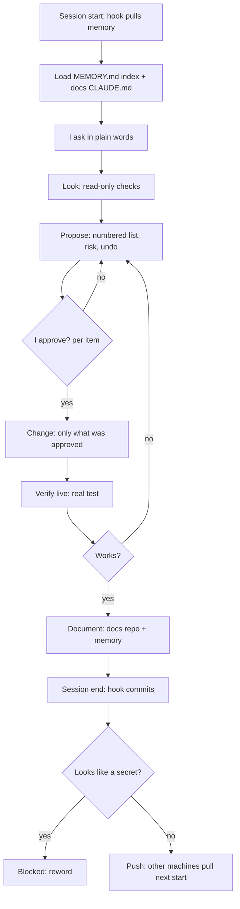

# Claude Code workflow demo

A **fake, cut-down copy** of how I run Claude Code as an IT assistant. All hosts, IPs, names and services
here are invented (IPs come from the 192.0.2.0/24 documentation range). The structure and the rules are real.

## The idea in one paragraph

Claude Code starts every session with no memory. I give it two things to read:

1. **A memory folder** (`memory/`): short notes about how I like to work, the rules it must follow, and
   one-line pointers to ongoing projects. It's a git repo, synced to every machine I use.
2. **A docs repo** (`docs-repo/`): the proper documentation for the systems: overviews, inventories, runbooks.

Every change follows the same loop: **look → propose → I approve → change → verify live → document**.

Open `diagrams/workflow.excalidraw` at <https://excalidraw.com> (File → Open) for the editable version.

## What's in here

| Path | What it shows |
|---|---|
| [guide/how-it-works.md](guide/how-it-works.md) | The session lifecycle and the change loop, step by step |
| [guide/guardrails.md](guide/guardrails.md) | The safety rules and why each one exists |
| [guide/example-session.md](guide/example-session.md) | A worked example: "the file share is slow" |
| [memory/](memory/) | Sample memory: index + one fact per file |
| [docs-repo/](docs-repo/) | Sample docs repo with its own `CLAUDE.md` rules for the AI |
| [tooling/](tooling/) | The sync hook, the secret-blocking pre-commit guard, the settings snippet |

## What this is *not*

- Not autonomous. Claude can investigate freely, but **every change waits for my yes**.
- Not a place for secrets. Memory and docs record *what kind* of secret and *where it lives*
  (e.g. "in the password manager"), never the value. A git hook blocks commits that look like one.
- Not a place for user data. Ticket contents, student or staff details never go into a hosted AI model.
